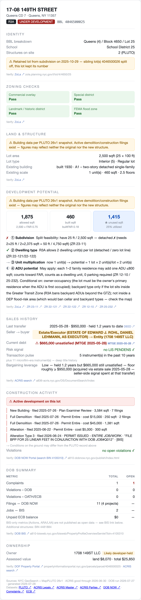

# Queens Lot Card

**Type any Queens address, get a one-page investment "lot card" in ~30 seconds — built entirely on free NYC Open Data, every number linked back to its official source.**

[](https://queens-lot-card.streamlit.app)  **Try it in your browser — no install, no API keys.**

Built for a small Queens developer whose business is low-density teardowns: buy an old house → demolish → subdivide if the zoning allows → build two-family homes → sell. The card answers the five questions that deal screening starts with: *what can legally be built here, what is already there, what did the current owner pay and owe, who is pulling permits nearby, and how motivated is the seller?*

<p align="center">
  
</p>

> Example cards: [17-08 149th St, Whitestone (R3A teardown, under development)](examples/4046500025_17-08-149th-st-queens-ny.md) · [133-25 37th Ave, Flushing (C4-2 mixed-use condo — an out-of-scope stress test)](examples/4049700011_133-25-37th-ave-flushing-ny-11354.md)

## What's on the card

| Section | What it tells you | Source |
|---|---|---|
| Identity | BBL breakdown, school district, buildings on lot, subdivision / merge history (`appbbl` three-way test) | GeoSearch, MapPLUTO |
| Zoning checks | Four veto flags: commercial overlay, special district, landmark/historic, FEMA flood | MapPLUTO |
| Land & structure | Lot area, frontage × depth, lot type, building class, units, floors, year built | MapPLUTO |
| Potential | Allowed FAR vs. built → **unused buildable area**; subdivision feasibility (detached vs. semi-detached minimums); unit multiplier; ADU conditions — each line cites the Zoning Resolution section | `rules.py` (13 R-districts, verified against current ZR incl. City of Yes 2024) |
| Sales history | Last deed, buyer/seller type, open mortgages (matched against satisfactions), lis pendens, **bargaining-room score** | ACRIS (Legals → Master → Parties) |
| Construction activity | Active filings grouped into projects, "under development" banner on NB / full demolition, open DOB + ECB violations and unpaid balances | DOB NOW, BIS, DOB/ECB violations |
| DOB summary | BIS-style property profile counts with a direct BIS link | DOB complaints, filings, violations |
| Ownership | Owner of record (latest ACRIS deed, PLUTO as fallback), motivation signals (estate, LLC, long tenure), tax assessment | ACRIS, MapPLUTO |

Every section ends with a grey **Verify ↗** line linking to ZoLa, the ZR text, the ACRIS document, DOB NOW, or the DOF property portal — the card is designed to be checked, not trusted.

## Quick start

**Online:** open [queens-lot-card.streamlit.app](https://queens-lot-card.streamlit.app), pick an example or type an address, click *Generate card*. (Free tier: the app sleeps when idle and takes ~30 s to wake.)

**Locally (CLI, adds PNG/PDF output):**

```bash
git clone https://github.com/charleschaohu-hash/queens-lot-card.git
cd queens-lot-card
pip install -r requirements.txt
playwright install chromium          # optional, for PNG/PDF output

python3 src/lot_card.py "17-08 149th St, Queens, NY"
python3 src/lot_card.py "17-08 149th St, Queens, NY" --fresh   # bypass cache

streamlit run app.py                 # same pipeline behind a local web UI
```

No API keys needed — all seven datasets are public NYC Open Data / Socrata endpoints. Output lands in `cards/{BBL}_{slug}.{md,html,png,pdf}` (a PDF copy also goes to `~/Desktop/地块档案卡/`). Raw API responses are cached per BBL under `cache/` so re-runs are instant and every figure can be traced to its JSON.

Run the subdivision-rule unit tests with `python3 tests/test_split.py`.

## How it's built

```
app.py            Streamlit front end: address box → build_card() → HTML card + downloads
src/lot_card.py   address → BBL → PLUTO → rules → ACRIS → DOB → render (md/html/png/pdf)   ~1,400 lines
src/rules.py      zoning rule table for R1–R5 districts, each value tagged with its ZR section
src/acris.py      three-table ACRIS chain, legacy-document routing, mortgage ↔ satisfaction matching, party classifier
src/dob.py        DOB NOW + BIS dual-system aggregation, project-group lifecycle, violations & ECB balances
skills/           field notes: API quirks (four datasets, four borough-code formats), zoning verification log
reports/          blind-test round (12 addresses → 6 defects fixed same day), code review, a Flushing condo deep dive
tests/            unit tests for subdivision feasibility
examples/         two finished cards
```

Design rules that came out of the earlier, harder-to-debug version of this idea:

- **Fetching and judging are separated.** Scripts fetch, cache, compute and render deterministically — same input, same card, zero LLM tokens. Interpretation (deal memos, one-off deep dives) happens on top of the files, in Claude Code, using `skills/` as the knowledge base.
- **Ambiguity stops the run.** Queens hyphenated addresses (`17-08` vs `8-17` vs `17-17`) resolve to different lots; multiple BBL candidates are shown and the choice is persisted, never silently taken.
- **Uncertain conclusions say so on the card.** Commercial/manufacturing districts downgrade the potential section; active demolition flags the PLUTO building figures as stale; ADU output is conditional where the data source doesn't exist.

The whole project was built with [Claude Code](https://claude.com/claude-code) in a loop of *learn the data source → write a task brief → build → blind-test on unseen addresses → fix*. The Chinese development log with the full change history is in [README.zh.md](README.zh.md).

## Known limits

- Zoning rules cover residential R-districts only; C/M districts get a flagged, partial card.
- Greater Transit Zone boundaries and DEP flood-risk maps have no per-lot open dataset, so ADU feasibility is reported as conditions rather than a verdict.
- BIS web pages block automated clients, so BIS links are constructed, not verified, by the tool.
- MapPLUTO is a periodic snapshot; DOB and ACRIS update daily. Lots recently subdivided can show up in DOB before PLUTO and ACRIS catch up.

## License

MIT — see [LICENSE](LICENSE). Data is © City of New York, via NYC Open Data.
